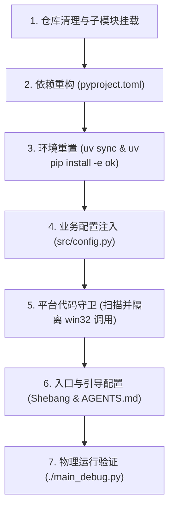

# 基于 ok-script-linux 的自动化项目 Linux 移植实操指南

本文档面向开发者或自动化 Agent，提供将任意基于 `ok-script` (2.x) 开发的 Windows 自动化工具完整移植到 Linux (Proton/Wine) 运行环境的标准流程。

---

## 移植全流程速览

整个移植过程分为七个阶段，按顺序执行：



---

## 第一阶段：仓库清理与子模块挂载

Windows 项目中常夹带 Windows 打包配置文件、PowerShell 测试脚本和硬编码的 Python 版本约束。

### 1. 物理移除 Windows 专用文件

在项目根目录下删除以下文件（若存在）：

- `pyappify.yml`
- `deploy.txt`
- `run_tests.ps1`
- `.python-version`

### 2. 挂载 ok-script-linux 子模块

执行以下命令将 Linux 框架作为子模块接入根目录的 `ok/` 文件夹：

```bash
git submodule add -b master git@github.com:Viemean/ok-script-linux.git ok
```

> 若上游项目原本含有其他素材子模块（例如 `ok_templates`），确保运行：
>
> ```bash
> git submodule update --init --recursive
> ```

---

## 第二阶段：依赖重构 (`pyproject.toml`)

上层 Windows 项目通常在 `pyproject.toml` 中声明了 `ok-script==2.0.x`、`pywin32` 以及 Windows 打包工具。在 Linux 下必须将 `ok-script` 移出外部依赖（转由子模块提供），剔除 `pywin32`，并补充 Linux 平台底层库。

### 1. 依赖替换标准对照

打开根目录 `pyproject.toml`：

```diff
 [project]
-name = "my-game-script"
+name = "my-game-script-linux"
-requires-python = ">=3.12,<3.13"
+requires-python = ">=3.12"
 dependencies = [
-    "ok-script==2.0.6",
-    "pyautogui==...",
-    "playwright==...",
     "PySide6-Essentials==6.11.1",
     "PySide6-Fluent-Widgets==1.10.5",
     "PySideSix-Frameless-Window==0.7.3",
     "onnxocr-ppocrv5==0.0.14",
     "openvino==2026.0.0",
     "opencv-python==4.12.0.88",
     "numpy>=2.0.0",
     "Pillow>=10.0.0",
     "json5>=0.15.0",
     "imagehash>=4.3.2",
     "pynput>=1.8.2",
+    "python-xlib>=0.33",
+    "pulsectl>=24.12.0",
+    "evdev>=2.0.0",
+    "mss>=10.2.0",
+    "psutil>=7.0.0",
 ]
-
-[tool.uv]
-override-dependencies = [
-    "pywin32==311; sys_platform == 'win32'",
-]
```

### 2. 补充依赖功能说明

- `python-xlib`：X11 窗口生命周期监听、客户区几何坐标计算与根窗口属性检索；
- `pulsectl`：连接 PipeWire / PulseAudio 协议，控制后台游戏音频流静音；
- `evdev`：通过 `/dev/uinput` 写入 Linux 内核输入事件；
- `mss`：X11 / Wayland 兜底通用截屏服务；
- `psutil`：跨平台进程树扫描与 Wine 宿主环境提取。

---

## 第三阶段：环境重置与可编辑安装

由于原项目的 `uv.lock` 包含针对 Windows 平台编译的锁死信息（如 Windows-only wheel、`pywin32`），必须将其彻底重建。

### 1. 重新锁定与安装

在项目根目录下依次执行：

```bash
# 1. 删除旧的 lockfile
rm -f uv.lock

# 2. 重新解析依赖并生成 Linux 专属 lockfile
uv lock

# 3. 将本地子模块以 editable 形式注入虚拟环境
uv pip install -e ok
```

> **注意**：如果当前宿主机器已存在完整的相同基础库（如已有 PySide6、OpenVINO、OpenCV），可直接复用缓存加速同步。

---

## 第四阶段：业务配置注入 (`src/config.py`)

Linux 自动化框架通过配置字典中的字段识别 Proton 游戏窗口、挂载输入代理与采集通道。

### 1. 修改 `config["windows"]` 字典

打开 `src/config.py`，定位到 `config["windows"]`，按以下对照修改：

```diff
 "windows": {
     "exe": ["TargetGame.exe"],
+    "title": r"TargetGameTitleRegex|TargetWindowClass",
+    "audio_targets": ["TargetGame.exe"],
     "args": ["-start=game_launcher"],
     "hwnd_class": "TargetWindowClass",
-    "interaction": [GameInteraction],
-    "capture_method": ["WGC", "ForegroundBitBlt", "BitBlt"],
+    "interaction": [
+        "ok.device.interaction_methods.linux_proton_post_message.LinuxProtonPostMessageInteraction",
+        "ok.device.interaction_methods.wine_agent_client.WineAgentInteraction",
+        GameInteraction,
+    ],
+    "capture_method": ["LinuxVulkanCaptureMethod", "LinuxWindowCaptureMethod", "WGC", "ForegroundBitBlt", "BitBlt"],
     "check_hdr": False,
     "force_no_hdr": False,
     "require_bg": True,
 },
```

### 2. 字段配置原则

- **`title`**：正则表达式，用于在 X11/XWayland 下匹配窗口标题（X11 下 Proton 容器中的窗口标题通常包含游戏英文名或窗口类名）。
- **`audio_targets`**：音频流过滤白名单列表，填入游戏二进制可执行文件名（如 `TargetGame.exe`），框架在失焦时只静音此列表中的进程。
- **`interaction`**：必须将 `LinuxProtonPostMessageInteraction` 与 `WineAgentInteraction` 置于首位；原有自定义业务交互类保留在后方兜底。
- **`capture_method`**：必须将 `LinuxVulkanCaptureMethod`（Vulkan Layer 显存直读）与 `LinuxWindowCaptureMethod`（XSHM 共享内存）置于最前。

---

## 第五阶段：平台代码守卫（清除代码中的 Win32 陷阱）

使用自动化检索工具扫描全部源码，排查直接导入 Windows API 的位置：

```bash
grep -rnE "(import win32|from win32|ctypes\.windll)" src/
```

针对扫描出的结果，依次使用以下 5 种标准防崩溃模式处理：

### 模式 1：顶层 Win32 导入防护与回退

**典型场景**：`src/core/base_mixin/runtime_mixin.py`、`src/interaction/mouse.py` 等模块在文件头无条件导入 `win32gui`。

**改造方案**：加入 `sys.platform == 'win32'` 判定，并在非 Windows 平台赋空，同时在具体函数内部做空值守护。

```python
import sys

if sys.platform == "win32":
    import ctypes
    import win32gui
    _user32 = ctypes.windll.user32
else:
    ctypes = None
    win32gui = None
    _user32 = None

def _find_window_by_class(class_name: str) -> int | None:
    if _user32 is None:
        return None
    hwnd = _user32.FindWindowW(class_name, None)
    return hwnd if hwnd else None
```

### 模式 2：目标窗口句柄查询路由适配

**典型场景**：`src/core/game_window.py` 中使用 `win32gui.EnumWindows` 与 `win32process.GetWindowThreadProcessId` 遍历桌面窗口获取 HWND。

**改造方案**：在非 Windows 平台直接拦截并从框架的 `og.device_manager.hwnd_window` 读取已由 Linux 适配层映射的虚拟窗口句柄。

```python
import sys

def find_game_hwnd(window_config: dict, timeout: float = 10.0, interval: float = 0.2) -> int:
    if sys.platform != "win32":
        try:
            from ok import og
            device_manager = getattr(og, "device_manager", None)
            hwnd_window = getattr(device_manager, "hwnd_window", None)
            return getattr(hwnd_window, "hwnd", 0) or 0
        except Exception:
            return 0
            
    # 原有 Windows 下 EnumWindows 查找逻辑保持不变...
```

### 模式 3：触发任务线程中的前台聚焦检测保护

**典型场景**：`src/tasks/trigger/*.py`（如音游任务、连点任务）在工作线程中调用 `win32gui.GetForegroundWindow()` 判断游戏是否失焦。

**改造方案**：将顶层 `import win32gui` 改为安全导入；在执行检测处如果 `win32gui` 为空，直接视为安全或由框架自身的失焦机制接管。

```python
import sys

if sys.platform == "win32":
    import win32gui
else:
    win32gui = None

# 在任务线程逻辑中：
def is_game_focused(self) -> bool:
    if win32gui is None:
        return True  # Linux 下依赖框架底层的焦点事件通知
    return win32gui.GetForegroundWindow() == self.hwnd
```

### 模式 4：键鼠操作中的 Windows 结构体隔离

**典型场景**：`src/interaction/mouse.py` 导入 `ctypes.wintypes` 并直接调用 `user32.mouse_event`。

**改造方案**：

```python
import sys

if sys.platform == "win32":
    import ctypes.wintypes
    import win32api
    import win32con
    import win32gui
    user32 = ctypes.windll.user32
else:
    ctypes.wintypes = None
    win32api = None
    win32con = None
    win32gui = None
    user32 = None
```

并在具体调用前检查：

```python
def move_relative(x: int, y: int):
    if user32 is None:
        # Linux 下由框架的 LinuxProtonPostMessageInteraction 或 uinput 处理
        return
    user32.mouse_event(MOUSEEVENTF_MOVE, x, y, 0, 0)
```

### 模式 5：Windows 平台专属补丁（Patches）设为 No-Op

**典型场景**：`src/patches/` 下针对 Windows GDI、WGC 截屏补丁（例如修复指针越界或时间戳）。

**改造方案**：在补丁入口处第一行添加 `sys.platform != "win32"` 返回，直接短路为无操作。

```python
def install_capture_timestamp_patch():
    global _INSTALLED
    if _INSTALLED:
        return
    import sys
    if sys.platform != "win32":
        _INSTALLED = True
        return
    # 原有针对 WindowsGraphicsCaptureMethod 的猴子补丁...
```

---

## 第六阶段：入口与引导配置

### 1. 入口脚本添加标准 Shebang 与执行权限

在 `main.py` 和 `main_debug.py` 的第一行添加标准 `uv` 引导标识：

```python
#!/usr/bin/env -S uv run
```

然后赋予执行权限：

```bash
chmod +x main.py main_debug.py
```

---

## 第七阶段：物理运行验证

### 1. 启动验证命令

在图形界面终端下启动带调试控制台的入口：

```bash
./main_debug.py
```

### 2. 验证达标检查单

- [ ] 控制台正常输出 `FeatureList` 特征加载与模板注册日志；
- [ ] 未抛出 `ModuleNotFoundError: No module named 'win32gui'` 或 `AttributeError: windll`；
- [ ] Qt 主窗口成功渲染并显示侧边栏与任务卡片；
- [ ] 启动/停止热键注册正常（默认绑定至 F9）。
